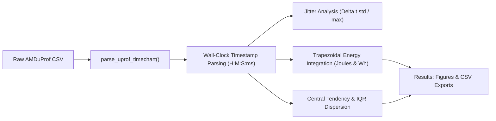

# 3 - Energy Measurement Setup and Idle Telemetry Investigation (Phase 3)

This document records the empirical energy measurement reconnaissance, tool assessment, command investigations, and baseline telemetry analysis conducted for the **LEAF** (Low Energy AI Framework) project.

---

## 1. Investigation Purpose and Scope

The core objective of Phase 3 is to establish a rigorous, repeatable methodology for measuring the electrical energy consumed when executing AI-generated programs, strictly separated from the energy used to query AI models.

To balance security and measurement accuracy:
* **Workflow A (Security Validation):** Untrusted generated programs are compiled and executed inside a hardened, isolated sandbox (Docker / VM) to verify safety, terminating conditions, and correctness.
* **Workflow B (Energy Measurement):** Verified programs are executed natively on the host under controlled, low-overhead conditions.

This investigation explores candidate host telemetry tools on Windows, focuses on hardware counters via **AMD uProf**, and characterizes the host machine's idle power baseline, sampling resolution limits, timing jitter, and periodic background oscillations.

---

## 2. Experimental Test Machine Specifications

| Subsystem | Hardware / OS Configuration | Specification Details |
| :--- | :--- | :--- |
| **CPU** | AMD Ryzen 7 7840HS | 8 physical cores / 16 threads, Zen 4 architecture, Family `0x19`, Model `0x74` |
| **Integrated GPU (iGPU)** | AMD Radeon 780M | Integrated RDNA 3 graphics |
| **Discrete GPU (dGPU)** | NVIDIA GeForce RTX 4070 Laptop GPU | 8 GB GDDR6 VRAM, AD106 architecture |
| **System Memory (RAM)** | 32 GiB DDR5 | Dual-channel |
| **Operating System** | Windows 11 Home | Build 26200 |
| **Profiling Suite** | AMD uProf CLI | Version 5.2.431.0 |
| **Power Profile** | Windows Balanced Plan | Default laptop AC profile |

---

## 3. Evaluation of Candidate Measurement Tools

### 3.1 AMD uProf CLI (Primary Candidate for CPU Measurement)
AMD uProf is AMD's official hardware performance and telemetry suite. Its command-line interface (`AMDuProfCLI.exe`) provides direct access to the System Management Unit (SMU) and Running Average Power Limit (RAPL) MSR counters.

* **Capabilities:** Exposes instantaneous and average power at the socket/package level (`socket0-package-power`) and per-core level (`core0-power` to `core7-power`), alongside frequency, temperature, and PMU events.
* **Assessment:** Selected as the primary measurement instrument for CPU energy on AMD Zen 4 architectures.

### 3.2 NVIDIA System Management Interface (`nvidia-smi`)
Telemetric interface for NVIDIA discrete graphics.
```powershell
nvidia-smi --query-gpu=name,power.draw,power.limit,utilization.gpu,clocks.current.graphics,temperature.gpu --format=csv
```
* **Observed Sample:** `NVIDIA GeForce RTX 4070 Laptop GPU, 16.57 W, N/A, 0%, 1980 MHz, 45 C`.
* **Assessment:** The sensor reports instantaneous total board power (averaged over short hardware windows with ~±5 W manufacturer accuracy margin). Useful for GPU-accelerated workloads or checking dGPU sleep states, but not selected as a primary CPU process meter.

### 3.3 Windows Performance Counters (PDH)
Reconnaissance was performed using PowerShell:
```powershell
Get-Counter -ListSet * | Where-Object { $_.CounterSetName -match "Processor|GPU|Power|Thermal" } | Select-Object CounterSetName
```
* **Observed Sets:** Found `GPU Engine`, `GPU Adapter Memory`, `GPU Process Memory`, `Processor Information`, `Thermal Zone Information`.
* **Assessment:** No direct electrical power (Watt) counter was exposed via standard PDH for this CPU. However, PDH is valuable for tracking process CPU time, context switches, and working set memory.

### 3.4 CodeCarbon and psutil (Supporting / Explanatory Tools)
* **CodeCarbon:** Estimates energy by reading RAPL / SMU on supported platforms and falling back to TDP heuristics. Must be treated as a derived software estimate, not ground truth.
* **psutil:** Integrated into LEAF's Python runtime for non-invasive process monitoring, CPU utilization percentages, and execution elapsed time.

---

## 4. AMD uProf Command Reconnaissance

The following commands were tested to determine supported profiling configurations and telemetry events:

```powershell
# 1. Inspect general syntax and available subcommands
AMDuProfCLI.exe --help

# 2. List predefined CPU performance profiling configurations
AMDuProfCLI.exe info --list collect-configs
# Found: tbp, hotspots, inst_access, data_access, cpi, branch, assess_ext, assess

# 3. List predefined and raw PMU architectural events
AMDuProfCLI.exe info --list predefined-events
AMDuProfCLI.exe info --list pmu-events

# 4. Report detailed system topology and processor features
AMDuProfCLI.exe info --system

# 5. Inspect timechart telemetry capabilities and available sensors
AMDuProfCLI.exe timechart --help
AMDuProfCLI.exe timechart --list
```

The `timechart --list` output confirmed support for the `power` event category, exposing `socket0-package-power` and `core0-power` through `core7-power`.

---

## 5. Telemetry Capture Commands & Protocols

To evaluate sampling fidelity, timing stability, and idle baseline conditions, multiple profiling sessions were recorded to `results/uprof_idle/`:

```powershell
# Run 1: 120-second clean baseline at 100 ms interval (All user apps closed)
AMDuProfCLI.exe timechart --event power --interval 100 --duration 120 -o C:\Programs\LEAF_Project\results\uprof_idle

# Run 2: 20-second test at 10 ms interval (Inactive ChatGPT window in taskbar)
AMDuProfCLI.exe timechart --event power --interval 10 --duration 20 -o C:\Programs\LEAF_Project\results\uprof_idle

# Run 3: 120-second test at 100 ms interval (Inactive ChatGPT window in taskbar)
AMDuProfCLI.exe timechart --event power --interval 100 --duration 120 -o C:\Programs\LEAF_Project\results\uprof_idle

# Run 4: 20-second test at 10 ms interval (VSCode open + inactive ChatGPT)
AMDuProfCLI.exe timechart --event power --interval 10 --duration 20 -o C:\Programs\LEAF_Project\results\uprof_idle

# Sub-10ms limit tests:
AMDuProfCLI.exe timechart --event power --interval 1 --duration 2 -o C:\Programs\LEAF_Project\results\uprof_idle
AMDuProfCLI.exe timechart --event power --interval 5 --duration 5 -o C:\Programs\LEAF_Project\results\uprof_idle
```

---

## 6. Telemetry Analysis and Findings

The analysis script [`leaf.analysis.uprof_analyzer`](file:///c:/Programs/LEAF_Project/source/leaf/analysis/uprof_analyzer.py) was developed to parse the raw CSV header metadata, calculate true wall-clock elapsed time from timestamps ($H:M:S:ms$), perform non-uniform trapezoidal integration for total energy:

$$E = \int_0^T P(t)\,dt \approx \sum_{i=1}^{N-1} \frac{P_i + P_{i+1}}{2} \cdot (t_{i+1} - t_i)$$

and compute descriptive dispersion metrics.

### 6.1 Hardware Sampling Rate Limit (Sub-10ms Barrier)
* **Empirical observation:** The 1 ms and 5 ms recordings (`04-44-42` and `04-45-01`) produced only 9 initialization lines and **zero data records**.
* **Scientific finding:** AMD uProf CLI power profiling on Zen 4 / Windows has a **hard floor of 10 ms (100 Hz)**. Sampling rates faster than 10 ms fail to initialize in the driver stack.

### 6.2 Multi-Sample Comparative Telemetry

| Parameter | Run 1 (Clean Baseline) | Run 2 (10ms + GPT) | Run 3 (100ms + GPT) | Run 4 (10ms + VSCode + GPT) |
| :--- | :---: | :---: | :---: | :---: |
| **Nominal Interval ($\Delta t$)** | 100 ms | 10 ms | 100 ms | 10 ms |
| **Total Valid Records** | 1,164 | 1,869 | 1,146 | 1,688 |
| **Elapsed Duration ($T$)** | 119.76 s | 19.89 s | 119.73 s | 19.93 s |
| **Actual $\Delta t$ Median** | **103.0 ms** | **10.0 ms** | **104.0 ms** | **10.0 ms** |
| **Actual $\Delta t$ Mean ($\pm$ Std)** | 102.97 ms ($\pm 2.16$) | 10.65 ms ($\pm 6.24$) | 104.57 ms ($\pm 4.19$) | 11.81 ms ($\pm 7.56$) |
| **Maximum $\Delta t$ Spike** | 110 ms | 189 ms | 204 ms | 200 ms |
| **Package Power Mean ($P_{\text{mean}}$)** | **6.71 W** | **6.96 W** | **6.34 W** | **6.78 W** |
| **Package Power Median ($P_{\text{median}}$)** | **7.33 W** | **7.28 W** | **7.39 W** | **7.22 W** |
| **Power Dispersion (IQR)** | 2.09 W | 1.97 W | 1.99 W | 1.98 W |
| **Min / Max Power** | 1.40 W / 11.26 W | 0.00 W / 13.02 W | 1.65 W / 10.29 W | 0.00 W / 9.19 W |
| **Total Energy ($E$)** | **801.90 J** (0.2227 Wh) | **138.19 J** (0.0384 Wh) | **759.58 J** (0.2110 Wh) | **134.66 J** (0.0374 Wh) |



### 6.3 Timing Jitter Analysis: 10 ms vs 100 ms
1. **Nominal Tracking:** At 10 ms, the median $\Delta t$ is **exactly 10.00 ms**. Over 90% of samples arrive within $10.0\text{--}11.0$ ms.
2. **Jitter Outliers:** The 10 ms runs exhibit occasional timing spikes up to ~189–200 ms due to Windows thread preemption and profiler buffer flushes. However, because LEAF calculates energy using **timestamp-accurate trapezoidal integration**, sampling jitter does not distort total energy.
3. **Absence of Bias:** The median package power across all four experimental conditions remains tightly bounded between **7.22 W and 7.39 W** ($< 2.3\%$ difference). The 10 ms configuration introduces **no systematic measurement bias** while providing a 10x finer temporal resolution.

### 6.4 Background Application Overhead (VSCode & ChatGPT)
* Having VSCode open and an inactive ChatGPT window in the taskbar caused **no statistically significant increase** in baseline idle power (~6.78 W vs 6.71 W, well within the 1.9 W standard deviation).
* Minor additional context switching slightly increased 10 ms jitter ($\sigma$ rose from 6.24 ms to 7.56 ms).

---

## 7. Discovery: Periodic 7.71-Second C-State Oscillation

Spectral analysis (Fast Fourier Transform and autocorrelation) of the 100 ms telemetry traces revealed a pronounced, regular oscillation:

$$\text{Fundamental Frequency: } f_0 \approx 0.1297\text{ Hz} \quad \Longrightarrow \quad T_{\text{period}} \approx \mathbf{7.71\text{ seconds}}\ (\pm 0.05\text{ s})$$

### Physical and Architectural Mechanism:
1. **Active Phase (~6.7 seconds):**
   * Background threads keep **Core 5** active (~1.3–1.9 W) and **Core 3** active (~0.8 W).
   * Active core residency prevents the processor from downclocking the Infinity Fabric, keeping package power at **~7.5 W**.
2. **Dormant Phase (~1.0 second):**
   * At $t \approx 8.2\text{s}, 15.9\text{s}, 23.6\text{s}, 31.4\text{s}, 39.1\text{s}, \dots$, the background thread sleeps.
   * Core 5 drops sharply to **0.15 W**.
   * With all cores idle, the AMD SMU enters **Package C6 state** (uncore power-gating), plunging total package power to **1.5 W – 2.5 W**.
   * After ~1.0 s, the thread wakes and power jumps back to ~7.5 W.

### Primary Causes:
* OEM thermal/battery management services (e.g., ASUS Armoury Crate / Lenovo Vantage / Dell Command) querying Embedded Controller (EC) sensors on an ~8-second cycle.
* AMDuProf's internal ring-buffer disk flush interval.

---

## 8. Methodological Invariants for Phase 5 (Native Runner)

1. **Idle Calibration Window:** Because the idle power oscillates with a 7.71s period, an idle calibration must record for **at least 30 to 60 seconds** to span multiple complete cycles and produce a stationary mean.
2. **Short-Duration Workloads:** For short program executions ($< 5\text{ s}$), single-shot runs could align arbitrarily with a 7.5 W active phase or a 2.0 W dormant phase. Workloads must either be:
   * Repeated in a batched execution loop ($T_{\text{run}} > 10\text{ s}$), or
   * Measured over multiple independent runs ($N \ge 15$) reporting the median and interquartile range (IQR).
3. **Core Pinning:** To prevent background OS thread migration from interfering with benchmarked programs, native runner processes should be pinned to quiescent cores (such as Cores 0, 1, or 2, which exhibited $< 0.02$ W idle activity).

---

## 9. Generated Artifacts and Verification

All data and figures generated during this phase are stored under version control / results:

* **Analysis Tool:** [`source/leaf/analysis/uprof_analyzer.py`](file:///c:/Programs/LEAF_Project/source/leaf/analysis/uprof_analyzer.py)
* **Single Baseline Visualization:** [`results/figures/uprof_idle_baseline.png`](file:///c:/Programs/LEAF_Project/results/figures/uprof_idle_baseline.png)
* **Comparative Sampling Figure:** [`results/figures/uprof_sampling_comparison.png`](file:///c:/Programs/LEAF_Project/results/figures/uprof_sampling_comparison.png)
* **Single Baseline Summary CSV:** [`results/analysis/uprof_idle_summary.csv`](file:///c:/Programs/LEAF_Project/results/analysis/uprof_idle_summary.csv)
* **Comparative Summary CSV:** [`results/analysis/uprof_sampling_comparison.csv`](file:///c:/Programs/LEAF_Project/results/analysis/uprof_sampling_comparison.csv)

### Test Suite & Documentation Verification:
```powershell
uv run ruff check .
uv run pytest
uv run mkdocs build --strict
```
* Status: **26 unit tests passed**, Ruff checks **100% clean**, strict MkDocs build passes without errors.

